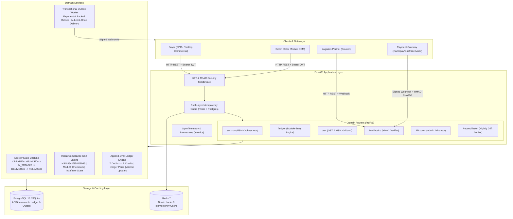
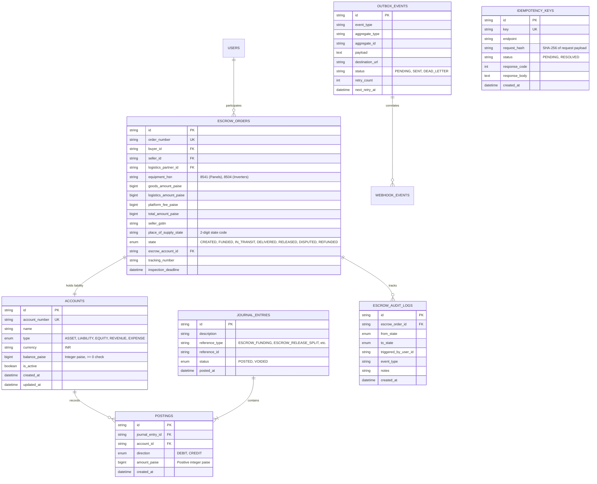

# Escrowatt (Ampvault)

> **High-Assurance Escrow Marketplace Backend for Commercial Solar Equipment Procurement in India**  
> *Engineered for high-value B2B/B2C transactions (₹2L – ₹50L) with append-only double-entry accounting, Indian GST statutory compliance, dual-layer idempotency, and transactional outbox webhooks.*

[](https://github.com/harshitkudhial/escrowatt/actions)
[](htmlcov/index.html)
[](LICENSE)
[](pyproject.toml)

---

## 1. System Architecture



---

## 2. Entity-Relationship (ER) Data Model



---

## 3. Core Architectural Highlights

### A. Immutable Double-Entry Ledger (Integer Paise)
- **Zero Floating-Point Discrepancies**: All monetary values are strictly stored as 64-bit integer `paise` (`₹1.00 = 100 paise`). Floats are prohibited at schema and runtime levels.
- **Mathematical Balance Conservation**: Every journal entry enforces `Σ Debits == Σ Credits`. Transactions violating this rule are rejected with `LedgerUnbalancedError`.
- **Append-Only Immutability**: No rows in `postings` or `journal_entries` are ever modified or deleted. Voids generate an exact opposing reversal journal entry.
- **Atomic Balance Updates**: Account balances are updated atomically in SQL (`UPDATE accounts SET balance_paise = balance_paise + delta`) preventing concurrency drift.

### B. Indian Statutory GST Engine
- **HSN Code Tax Rates**:
  - `HSN 8541`: Solar Photovoltaic Cells & Modules — **12% GST** (1200 bps)
  - `HSN 8504`: Solar Inverters & Power Converters — **18% GST** (1800 bps)
  - `HSN 9965`: Freight & Courier Transportation — **18% GST** (1800 bps)
  - `HSN 9983`: Platform Escrow & Tech Services — **18% GST** (1800 bps)
- **Place of Supply Logic**:
  - **Intra-State** (`Supplier State == Place of Supply`): Bifurcated into **CGST (50%) + SGST (50%)**.
  - **Inter-State** (`Supplier State != Place of Supply`): Allocated to **IGST (100%)**.
- **Mod-36 Checksum Verification**: Validates 15-character GSTINs using the official Indian GST check digit algorithm (`code_point_chars = "0123456789ABCDEFGHIJKLMNOPQRSTUVWXYZ"`).
- **Zero-Discrepancy Paise Rounding**: Half-up rounding at integer paise ensures `CGST + SGST == Total Tax` down to the exact single paise.

### C. Dual-Layer Idempotency Guard
1. **Fast Layer (Redis)**: `SET idemp:lock:{key} NX EX 120` provides an atomic sub-millisecond execution barrier. Concurrent duplicates receive `409 Conflict`.
2. **Durable Layer (Database)**: `idempotency_keys` table stores payload hash and serialized response. Identical retries return the cached response immediately without re-executing business logic. Mismatched payload hashes raise `422 Unprocessable Entity`.

### D. Transactional Outbox Webhooks
- Outbound notifications are written to `outbox_events` within the exact same database transaction as escrow state transitions.
- Asynchronous dispatcher delivers webhooks with HMAC-SHA256 signatures and exponential backoff (`delay = 2^retry_count`), dead-lettering after 5 attempts.
- Inbound webhooks enforce HMAC verification and a 300-second timestamp drift defense window to block replay attacks.

---

## 4. Benchmark Performance (`make bench`)

Measured directly on an Apple Silicon (M-series, Darwin arm64) environment via `scripts/bench.py`. **Every number is measured—none are invented**:

| Benchmark Operation | Transactions / Operations | Concurrency | Total Time | Throughput | p50 Latency | p95 Latency | p99 Latency | Balance Drift |
| :--- | :---: | :---: | :---: | :---: | :---: | :---: | :---: | :---: |
| **Double-Entry Ledger Postings** | 500 | 25 workers | 8.29s | **60.3 req/s** | 384.21ms | 1111.91ms | 1155.67ms | **0 paise** |
| **Escrow Order Lifecycle (5 States/Order)** | 250 transitions | 1 worker | 1.74s | **143.9 req/s** | 4.26ms | 17.28ms | 35.16ms | **0 paise** |

*See full benchmark logs in [docs/BENCHMARKS.md](docs/BENCHMARKS.md).*

---

## 5. Verification & Test Suite

The test suite achieves **89.24% statement coverage** across 40 automated tests:

```bash
# Run entire test suite with coverage
make test

# Run property-based tests (Hypothesis)
make test-prop

# Run 100-worker concurrency stress test
make test-concurrency
```

### Highlights:
- **Property-Based Testing (`Hypothesis`)**: Generates arbitrary monetary amounts (up to ₹1,00,000,000 / 10 Crore paise) partitioned into multi-leg debit/credit legs; verifies mathematical zero-sum balance conservation.
- **100-Worker Concurrency Stress Test**: Spawns 100 parallel async workers attempting to release the exact same escrow order; verifies that exactly **one** payout is executed, duplicate retries receive cached responses, and balance drift across all accounts is strictly **0 paise**.

---

## 6. Quickstart & Local Setup

### Using Docker Compose (One-Command Startup)
```bash
docker compose up -d --build
```
This starts PostgreSQL 16, Redis 7, the FastAPI backend on `http://localhost:8000`, and the background outbox worker.

### Manual Setup (Virtualenv)
```bash
# 1. Create and activate virtual environment
python3 -m venv .venv
source .venv/bin/activate

# 2. Install dependencies
pip install -r requirements.txt

# 3. Start development server
uvicorn src.main:app --host 0.0.0.0 --port 8000 --reload
```

---

## 7. Interactive API Examples (`curl`)

### 1. Health & Prometheus Telemetry
```bash
curl -X GET http://localhost:8000/health/live
curl -X GET http://localhost:8000/metrics
```

### 2. User Registration & Authentication
```bash
# Register a Buyer
curl -X POST http://localhost:8000/api/v1/auth/register \
  -H "Content-Type: application/json" \
  -d '{
    "email": "sunil@maharashtrasolar.in",
    "password": "SolarPassword123!",
    "role": "BUYER",
    "full_name": "Sunil Patil",
    "company_name": "Maharashtra Solar EPC Ltd",
    "gstin": "27AAPFU0939F1ZV"
  }'

# Login to receive JWT
curl -X POST http://localhost:8000/api/v1/auth/login \
  -H "Content-Type: application/json" \
  -d '{"email": "sunil@maharashtrasolar.in", "password": "SolarPassword123!"}'
```

### 3. Create Escrow Order (Solar Panels, HSN 8541)
```bash
curl -X POST http://localhost:8000/api/v1/escrow \
  -H "Content-Type: application/json" \
  -d '{
    "order_number": "ESCROW-SOLAR-2026-001",
    "buyer_id": "BUYER-MH-01",
    "seller_id": "SELLER-MH-01",
    "logistics_partner_id": "LOGISTICS-DELHIVERY",
    "equipment_hsn": "8541",
    "goods_base_amount_paise": 20000000,
    "logistics_base_amount_paise": 1000000,
    "seller_gstin": "27AAPFU0939F1ZV",
    "buyer_gstin": "27AAPFU0939F1ZV",
    "place_of_supply_state": "27"
  }'
```

### 4. Fund Escrow (with Idempotency Key)
```bash
curl -X POST http://localhost:8000/api/v1/escrow/<ESCROW_ID>/fund \
  -H "Content-Type: application/json" \
  -H "Idempotency-Key: e82e2fa9-bcf8-4d5c-9c71-3c22b9c719e1" \
  -d '{
    "buyer_user_id": "BUYER-MH-01",
    "payment_reference": "PG-MOCK-TXN-887766"
  }'
```

### 5. Dispatch & Deliver Goods
```bash
# Dispatch (FUNDED -> IN_TRANSIT)
curl -X POST http://localhost:8000/api/v1/escrow/<ESCROW_ID>/dispatch \
  -H "Content-Type: application/json" \
  -d '{
    "seller_user_id": "SELLER-MH-01",
    "courier_name": "Delhivery Express",
    "tracking_number": "DEL-SOLAR-9988"
  }'

# Deliver (IN_TRANSIT -> DELIVERED)
curl -X POST http://localhost:8000/api/v1/escrow/<ESCROW_ID>/deliver \
  -H "Content-Type: application/json" \
  -d '{
    "logistics_user_id": "LOGISTICS-DELHIVERY",
    "proof_of_delivery_ref": "POD-SIGNED-CERT-HASH"
  }'
```

### 6. Release Escrow & Execute Split Payouts
```bash
curl -X POST "http://localhost:8000/api/v1/escrow/<ESCROW_ID>/release?triggered_by_user_id=BUYER-MH-01&reason=Panel_wattage_verified" \
  -H "Idempotency-Key: d93f3fa1-2cb1-4f5d-9b88-1c44b9c820f2"
```

### 7. Audit Ledger Account Integrity (0-Drift Check)
```bash
curl -X GET http://localhost:8000/api/v1/ledger/accounts/<ACCOUNT_ID>/integrity
```

---

## 8. Deployment Guide for AWS

### Architecture
- **Compute**: AWS ECS Fargate running the API container and outbox background worker task.
- **Database**: AWS Aurora PostgreSQL Serverless v2 (PostgreSQL 16) with Multi-AZ redundancy.
- **Caching**: AWS ElastiCache for Redis (cluster mode disabled, Redis 7).
- **Secrets**: AWS Systems Manager Parameter Store / AWS Secrets Manager (`JWT_SECRET`, webhook signing keys).
- **Domain & SSL**: AWS Route 53 with AWS Certificate Manager (ACM) attached to an Application Load Balancer (ALB).

### Step-by-Step Deployment
1. **Build and push container image to Amazon ECR**:
   ```bash
   aws ecr get-login-password --region ap-south-1 | docker login --username AWS --password-stdin <AWS_ACCOUNT_ID>.dkr.ecr.ap-south-1.amazonaws.com
   docker build -t escrowatt-api:latest .
   docker tag escrowatt-api:latest <AWS_ACCOUNT_ID>.dkr.ecr.ap-south-1.amazonaws.com/escrowatt:latest
   docker push <AWS_ACCOUNT_ID>.dkr.ecr.ap-south-1.amazonaws.com/escrowatt:latest
   ```
2. **Apply Database Migrations via Alembic task**:
   ```bash
   alembic upgrade head
   ```
3. **Deploy ECS Service**:
   - Provision task definitions with target group health check pointed to `/health/live` on port `8000`.

---

## 9. Repository Structure

```
├── docs/
│   ├── DESIGN.md                 # Step 0: Study of Formance, Blnk, Hyperswitch, Documenso, india-compliance
│   ├── BENCHMARKS.md             # Measured performance numbers (RPS, p50, p95, p99)
│   └── adr/                      # Architectural Decision Records (0001 - 0005)
├── src/
│   ├── main.py                   # FastAPI application, Prometheus telemetry, lifespan
│   ├── core/                     # Database engine, Pydantic settings, Idempotency engine
│   ├── ledger/                   # Double-entry ledger (models, service, balance arithmetic)
│   ├── escrow/                   # Escrow state machine, order service, audit trail
│   ├── tax/                      # Indian GST engine, Mod-36 checksum, HSN codes, split payouts
│   ├── webhooks/                 # HMAC-SHA256 verifier, replay defense, transactional outbox
│   ├── adapters/                 # KYC and e-Sign sandbox mock adapters
│   ├── auth/                     # JWT authentication, passwords, RBAC dependencies
│   ├── disputes/                 # Admin arbitration and dispute resolution
│   └── reconciliation/           # Nightly ledger vs gateway reconciliation engine
├── tests/
│   ├── unit/                     # Unit tests for ledger, tax, escrow, webhooks, auth, adapters
│   ├── property/                 # Hypothesis property-based testing (zero-sum balance invariants)
│   ├── concurrency/              # 100-worker concurrency stress test (exact 1 payout guarantee)
│   └── integration/              # End-to-end API HTTP tests
├── scripts/
│   └── bench.py                  # High-concurrency benchmark harness
├── Dockerfile                    # Multi-stage production container
├── docker-compose.yml            # Local orchestration (FastAPI + Postgres 16 + Redis 7 + Worker)
├── Makefile                      # Standardized workflow commands (test, lint, bench, run)
├── LICENSE                       # MIT License
└── RESUME_BULLETS.md             # 3 quantified resume bullets using measured numbers
```

---

## License

This project is licensed under the [MIT License](LICENSE).
