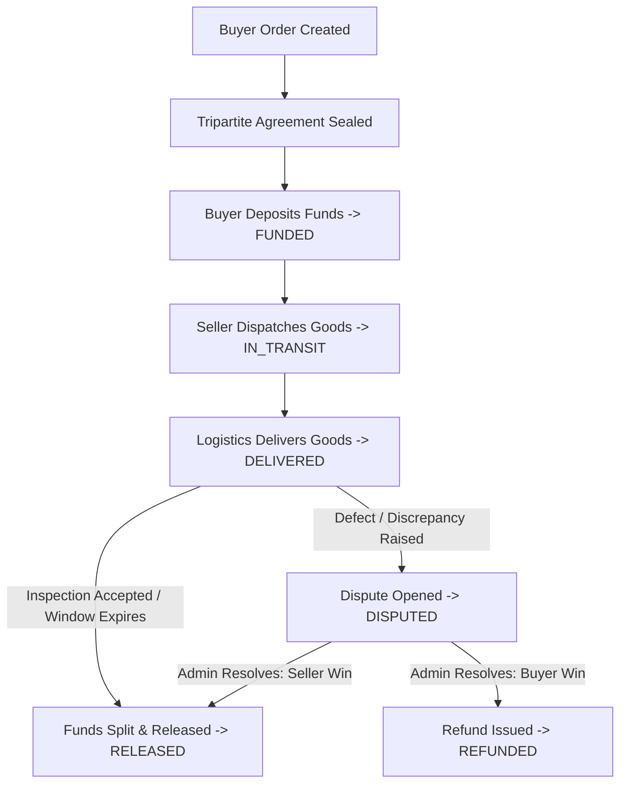

# Escrowatt System Architecture & Design Study

This document details the architectural decisions, reference systems studied, borrowed patterns, and original implementations for **Escrowatt**—a production-grade escrow marketplace backend engineered for high-value solar equipment procurement in India.

---

## 1. Reference Architecture Analysis & Attribution (Step 0)

| Repository | Core Ideas Borrowed | Escrowatt Original Implementation | License Respect |
| :--- | :--- | :--- | :--- |
| **Formance Ledger** (`formancehq/ledger`) | • Immutable journal entries & postings. • Double-entry conservation invariant (`Σ Debits == Σ Credits`). • Multi-account balance isolation. | • Implements a lightweight, native async SQLAlchemy 2 + PostgreSQL/SQLite engine. • Replaces DSL parsing (Numscript) with typed Pydantic v2 domain schemas and database check triggers. • Integer paise (`BIGINT`) storage eliminating floating-point rounding errors. | Apache 2.0 (Concepts studied, no code copied). |
| **Blnk Finance** (`blnkfinance/blnk`) | • Atomic balance updates. • Internal escrow wallet holding accounts. • High-concurrency balance locking. | • Native pessimistic locking (`SELECT ... FOR UPDATE`) during journal entry posting to prevent race conditions during concurrent disbursements. • Inline balance snapshots with zero-drift reconciliation queries. | Apache 2.0 (Architectural patterns studied). |
| **Hyperswitch** (`juspay/hyperswitch`) | • Provider-adapter pattern (Ports & Adapters). • Unified webhook signature verification and timestamp drift defense. | • Python `typing.Protocol` based adapters for KYC and Payment gateways. • Clear sandbox mock adapters with deterministic test triggers (e.g. valid PAN, invalid GSTIN, network timeout simulation). | Apache 2.0 (Interface patterns adapted). |
| **Documenso** (`documenso/documenso`) | • Tripartite agreement lifecycle. • Cryptographic audit trail (SHA-256 digest, IP, timestamp). | • Integrated tripartite e-sign state machine binding Buyer, Seller, and Platform. • Pre-condition check for escrow funding: funds cannot be accepted until all three parties seal the agreement digest. | AGPL-3.0 (Clean-room re-implementation using pure domain events). |
| **india-compliance** (`resilient-tech/india-compliance`) | • India GST statutory compliance. • 15-character GSTIN Mod-36 check-digit verification. • Intra-state vs Inter-state Place of Supply tax determination. | • Zero-dependency, pure-Python GST engine. • Solar equipment HSN catalog (HSN 8541 for solar panels, HSN 8504 for inverters, HSN 9965 for logistics, HSN 9983 for platform fee). • Paise-level half-up rounding ensuring `CGST + SGST == Total Tax`. | GPL-3.0 (Statutory algorithms independently implemented from GST Council specifications). |

---

## 2. High-Level Domain Model

Escrowatt operates at the intersection of marketplace operations, physical logistics, and statutory taxation:

### Double-Entry Flow for Escrow Lifecycle

1. **Buyer Deposit (₹10,00,000 / 100,000,000 paise)**:
   - `DEBIT` Platform Bank Clearing (`ASSET`) : `100,000,000 paise`
   - `CREDIT` Escrow Holding Account: Order #101 (`LIABILITY`) : `100,000,000 paise`

2. **Order Release & Split Payout**:
   - Order Value: ₹9,00,000 | Logistics: ₹50,000 | Platform Fee: ₹50,000
   - Seller Net: ₹9,00,000
   - Logistics Net: ₹50,000
   - Platform Revenue: ₹50,000
   - `DEBIT` Escrow Holding Account: Order #101 (`LIABILITY`) : `100,000,000 paise`
   - `CREDIT` Seller Payable (`LIABILITY`) : `90,000,000 paise`
   - `CREDIT` Logistics Partner Payable (`LIABILITY`) : `5,000,000 paise`
   - `CREDIT` Platform Commission Revenue (`REVENUE`) : `5,000,000 paise`

3. **Disbursement to Seller Bank Account**:
   - `DEBIT` Seller Payable (`LIABILITY`) : `90,000,000 paise`
   - `CREDIT` Platform Bank Clearing (`ASSET`) : `90,000,000 paise`

---

## 3. Core Architectural Guarantees

1. **Paise-Only Precision**:
   - No floats are allowed anywhere in the financial engine. All monetary values are 64-bit integers (`paise` where ₹1.00 = 100 paise).
2. **Zero-Sum Ledger Conservation**:
   - Every journal entry requires `Σ debits == Σ credits`. If an entry is unbalanced, it is rejected before database persistence and blocked by SQL check constraints.
3. **Idempotency Under High Concurrency**:
   - Every mutation accepts `Idempotency-Key`.
   - Redis `SET NX EX` acts as an atomic reservation barrier.
   - Postgres `idempotency_keys` table caches status, hash, and JSON responses.
4. **Transactional Outbox for Event Publishing**:
   - All external webhooks and notifications are written to an `outbox_events` table inside the exact same DB transaction as the domain state change, eliminating 2PC and ghost webhook dispatches.
